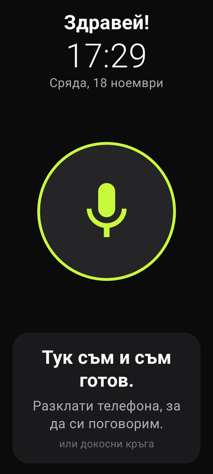
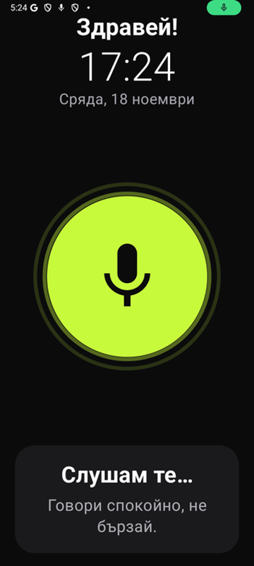
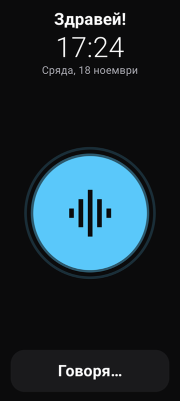
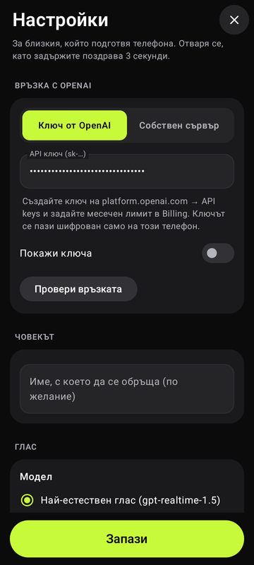

# Събеседник: a shake-to-talk voice companion

**Shake the phone. A warm Bulgarian voice says hello. Just talk.**

Събеседник ("companion") turns an Android phone into a voice companion for an elderly person who
doesn't use smartphones. Nothing to tap and nothing to read: shake the phone, and a friendly AI
greets them in Bulgarian, listens patiently and talks back like someone on the phone. Say
„довиждане“ (or shake again) and it hangs up.

<p>




</p>

Everything on screen and everything it says is in Bulgarian. The voice is OpenAI's Realtime
speech-to-speech model, so turns flow naturally and he can interrupt it. It also waits through
long pauses.

---

## Setting it up (about 20 minutes, done once by a family member)

You need an Android phone (Android 8 or newer) and an OpenAI account with a payment method.

### 1. Get an OpenAI API key

1. Go to [platform.openai.com](https://platform.openai.com) and sign in (or create an account).
2. **Billing** → add a payment method and some credit (e.g. $10).
3. **Limits** → set a **monthly budget** (e.g. $20) so the bill can never surprise you.
4. **API keys** → *Create new secret key* → copy it (it starts with `sk-`). Keep it somewhere safe.

> Tip: before going further, try the voice in the
> [Realtime playground](https://platform.openai.com/playground/realtime). Speak Bulgarian slowly,
> the way he would, and check you like how it sounds.

### 2. Install the app

1. On the phone, open the [latest release](https://github.com/oktayshakirov/grandpa-voice/releases/latest) and download `Sabesednik.apk`.
2. Open the downloaded file. Android asks to allow installing apps from your browser: allow it, then **Install**.
3. Open **Събеседник** and allow the **microphone** and **notifications**.

### 3. Connect it to OpenAI

1. Tap the green **Настрой** button.
2. Paste your key into **API ключ**.
3. Type his name in **Име** (e.g. „Иване“ or „дядо Иван“). This is how it will address him.
4. Tap **Провери връзката**. You should see a green „✓ Връзката работи“.
5. Tap **Запази**. Now shake the phone and say hello!

The key is stored encrypted on this phone only.

### 4. Make the phone "his" (recommended)

In the app's settings, under **Телефон**:

- **Изключи оптимизацията на батерията**: stops Android from putting the app to sleep.
- **Направи го начален екран (Home)**: choose Събеседник as the Home app, *Always*. Then it
  starts by itself after a restart, and the Home button always comes back to it.

In Android's own settings:

- **Screen lock: None.** With a PIN, the phone waits for the PIN after a restart and the app can't start.
- **Volume up**, and Wi‑Fi set to reconnect automatically.
- **Text‑to‑speech:** install the Bulgarian voice for Google's speech engine. It is used to say
  problems out loud ("Няма връзка с интернет") when OpenAI can't be reached.
- Keep the phone **on a charger or stand**. Listening for shakes with the screen off uses battery.
- Samsung, Xiaomi, Huawei and similar phones have extra battery savers. See [docs/PHONE_SETUP.md](docs/PHONE_SETUP.md).

**Hidden settings:** press and hold „Здравей!“ at the top for 3 seconds.

---

## How he uses it

| He does | It does |
|---|---|
| Shakes the phone (a few firm shakes) | Beeps, buzzes, says hello and asks how he is |
| Talks, pauses, thinks, carries on | Waits patiently, then answers in short, warm sentences |
| Talks while it is speaking | Stops and listens |
| Says „довиждане“, „чао“, „лека нощ“… | Says goodbye and hangs up |
| Shakes again during a call | Hangs up straight away |
| Stays silent for 2 minutes | Says it's here whenever he wants, and hangs up |

The circle's colour tells him what is happening: **green** = speak, I'm listening; **blue** = I'm
talking; **orange** = one moment; **red** = something went wrong (also said out loud).
Touching the circle also starts or ends a conversation.

## What it costs

- **The app:** free.
- **OpenAI:** you pay per minute of conversation (billed in audio tokens). Expect roughly a few
  cents per minute; long conversations cost a bit more per minute. Check
  [openai.com/api/pricing](https://openai.com/api/pricing). In settings you can pick the cheaper
  `gpt-realtime-2.1-mini` model instead of the default `gpt-realtime-1.5`. **Set the monthly budget
  limit** (step 1), and the most you can ever pay is that amount.
- Each conversation stops by itself after 30 minutes (adjustable).

## Good to know

**Works well**
- Shake → conversation, with the screen on or off, while the phone sits on its charger.
- Natural turn-taking, interruptions, echo cancellation. Bluetooth headsets and speakers are used automatically.
- Comes back by itself after a restart (when set as the Home app and the screen lock is None).

**Android's limits**
- To notice a shake with the screen off, the app keeps the processor awake. Fine on a charger, but it drains a battery.
- Some phone brands kill background apps aggressively. Follow [docs/PHONE_SETUP.md](docs/PHONE_SETUP.md) §4.
- Nothing can detect a shake when the phone is switched off or the app was force-stopped.
- The app shows a quiet notification all the time. Android requires it for anything that keeps
  running in the background.
- How well it understands strong regional accents depends on OpenAI's model. Test it with him early.

**Privacy**
- Nothing is recorded or saved: no audio, no transcripts. Audio streams to OpenAI over encrypted WebRTC.
- OpenAI's [API data policy](https://openai.com/enterprise-privacy) applies; API data is not used for training by default.

---

## For developers

### Build

Requirements: JDK 17 and the Android SDK (API 35). Android Studio works, as does the command line:

```bash
./gradlew assembleDebug          # app/build/outputs/apk/debug/app-debug.apk
./gradlew testDebugUnitTest      # unit tests (shake detection, session config)
./gradlew assembleRelease        # release APK (see "Signing" below)
```

**Signing:** create `keystore.properties` in the project root (git-ignored):

```properties
storeFile=/absolute/path/to/release.jks
storePassword=...
keyAlias=...
keyPassword=...
```

Without it, release builds fall back to the debug key. Keep the same keystore for every
update: Android refuses an update signed with a different key.

### Architecture

```
┌───────────────── Android phone ─────────────────┐                     ┌──────── OpenAI ────────┐
│ MainActivity / MainScreen (Compose)             │                     │                        │
│        ▲ UiState (StateFlow)                    │  1. short-lived key │ /v1/realtime/          │
│ CompanionService (foreground service)           │ ───────────────────▶│   client_secrets       │
│  ├ ShakeDetector → ShakeLogic (accelerometer)   │                     │                        │
│  └ ConversationManager                          │  2. WebRTC call     │                        │
│      ├ KeyProvider  (key on phone OR your server)│ ───────────────────▶│ /v1/realtime/calls     │
│      ├ RealtimeClient (WebRTC, "oai-events")    │ ◀── voice + events ─│                        │
│      └ AudioRouter, Sounds (beeps, local TTS)   │                     │                        │
└─────────────────────────────────────────────────┘                     └────────────────────────┘
```

- **Voice engine:** OpenAI Realtime API (GA) over WebRTC. Audio goes straight between the phone
  and OpenAI; events (greeting, turn changes, the `end_conversation` tool call) travel on the
  `oai-events` data channel.
- **Keys:** the WebRTC call only ever sees an ephemeral key that expires after 60 seconds. It comes either
  - from **OpenAI directly**, using a key stored on the phone (Android Keystore AES-GCM, backups
    disabled). This is the simplest setup for one family phone. Use a key with a budget limit. Or
  - from **your own token broker** ([backend/](backend/README.md), zero-dependency Node) so the
    permanent key never touches the phone. Use this if you hand out more than one phone or publish the app.
- **Shake detection:** several distinct acceleration spikes above a threshold within a time
  window, then a cooldown (`shake/ShakeLogic.kt`, unit-tested). Everything is tunable live in the settings.
- **Screen off:** a foreground service (microphone + special-use type) plus a partial wake lock
  keeps the accelerometer running. A shake wakes the screen and shows the app over the lock screen.
- **Kiosk mode (optional):** device-owner lock-task mode, see [docs/PHONE_SETUP.md](docs/PHONE_SETUP.md) §5.

```
app/src/main/java/com/grandpavoice/
  conversation/  KeyProvider, SessionConfig, RealtimeClient, ConversationManager, Instructions, AudioRouter, Sounds
  shake/         ShakeLogic (pure algorithm), ShakeDetector (sensor glue)
  service/       CompanionService (foreground service), Notifications
  settings/      Settings, SettingsRepository, SecretStore (Keystore encryption), Defaults (Bulgarian prompt)
  ui/            MainActivity, MainScreen, SettingsScreen, Theme
  kiosk/         optional device-owner lock-task mode
backend/         optional token broker (Node 20, Dockerfile)
tools/mock-realtime/  fake OpenAI Realtime server for testing without credits
docs/            phone setup, testing checklist
```

### Testing without OpenAI credits

[`tools/mock-realtime`](tools/mock-realtime/mock_server.py) stands in for OpenAI. The phone
makes a real WebRTC call to it: microphone audio flows up, a Bulgarian voice (the macOS "Daria"
voice) flows back, and it sends the same events OpenAI sends. That exercises shake detection, audio,
the whole conversation state machine, hanging up, and error handling.

```bash
cd tools/mock-realtime
python3 -m venv .venv && .venv/bin/pip install -r requirements.txt
.venv/bin/python mock_server.py                              # normal scripted conversation
MOCK_FAIL=insufficient_quota .venv/bin/python mock_server.py # simulate an account with no credit
```

In a **debug** build: settings → **Собствен сървър** → address `http://10.0.2.2:8788` (emulator) or
`http://<your computer's IP>:8788` (phone on the same Wi‑Fi), token `mock-device-token-for-local-testing`.
On an emulator, a shake can be simulated with `adb emu sensor set acceleration 28:4:9.8` followed by
`adb emu sensor set acceleration 0:0:9.8`, repeated about five times.

What was verified this way (Android 16 emulator):

- shake → greeting → listening → reply → goodbye + `end_conversation` → standby
- a second shake ends a call
- a shake with the screen off wakes the phone and starts a call
- microphone audio streams the whole call and is released afterwards
- "no credit" and "wrong key" errors are shown and spoken in Bulgarian

Against the **real OpenAI API** (an account without credit):

- OpenAI accepts the app's session config (model, Bulgarian instructions, patient turn detection,
  voice, `end_conversation` tool) for both `gpt-realtime-1.5` and `gpt-realtime-2.1-mini`
- the full chain works up to the call: app → token broker → OpenAI key → WebRTC offer to OpenAI.
  OpenAI then refuses the call for lack of credit, and the app says so in Bulgarian
- a wrong key is reported as such

**Not yet verified:** hearing the actual Bulgarian replies (needs credit) and behaviour on physical
phones from different brands. Run [docs/TESTING.md](docs/TESTING.md) on the real phone.

### Before publishing to Google Play

- Use the token broker (or your own backend with accounts) instead of a key typed into the phone.
- The prompt is written for a man (*него*, *го*). Add a gender setting before publishing more widely.
- Google Play restricts `FOREGROUND_SERVICE_SPECIAL_USE`, the HOME launcher category and
  `REQUEST_IGNORE_BATTERY_OPTIMIZATIONS`. Expect to justify them in the Play Console declarations.
- Add a privacy policy (microphone audio is sent to OpenAI).

## License

[MIT](LICENSE)
